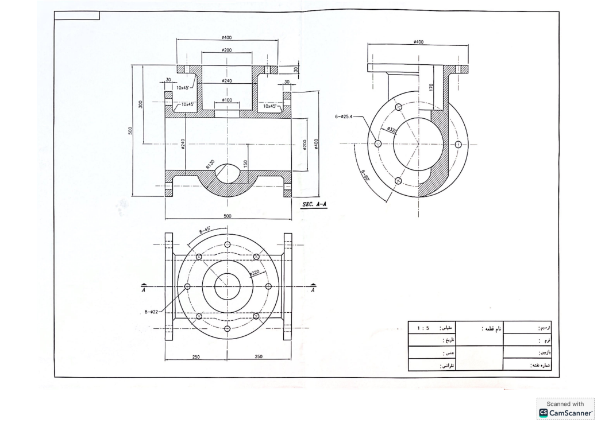
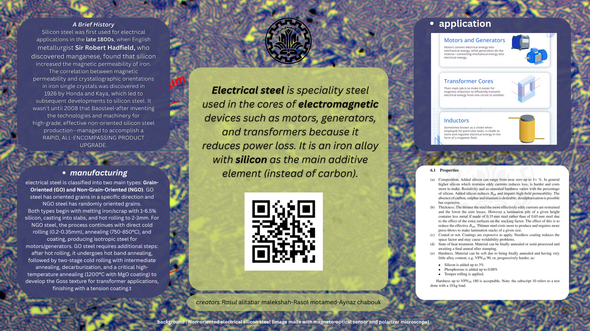

# Hi, I'm Aynaz

### Materials science · Processing · Design

My academic portfolio explores how material structure and processing influence performance, from self-healing polymers to cast steel components and electrical steels.

## Selected projects

### Austempering of DF2 Steel

A two-person Physical Metallurgy Laboratory II project examining heat treatment and optical microstructure in DF2 steel. The report discusses the 15-minute specimen after austempering at 320 degrees Celsius and the observed martensitic and bainitic microstructure.

[Read the laboratory report](project%20report.pdf)

*Co-authored by Aynaz Chabouk and Nima Eslam Beik. Instructor: Dr. Mostafa Karami. Original report in Persian; public cover omits student identifiers.*

### Self-Healing Conductive Polymers

A group literature review of healing mechanisms, electronic and ionic conductivity, synthesis, fabrication, and electronic-skin applications.

**Topics:** conductive hydrogels · dynamic bonds · PEDOT:PSS · wearable sensors

[Read the report](self-healing-conductive-polymers.pdf)

*Group coursework with Soroush Al Mohammad and Morteza Nouri. Original report in Persian.*

### Gate Valve Body Casting Design

An individual design study covering material selection, sand cores, riser sizing, gating calculations, inspection planning, and finishing operations.

[Read the design report](gate-valve-casting-design.pdf) · [View the supplied technical drawing](gate-valve-drawing.pdf)

*Principles of Solidification and Casting coursework. Original report in Persian; design calculations have not been independently validated for production.*

### Electrical Steel: Processing and Applications

A group academic poster comparing grain-oriented and non-grain-oriented electrical steels, their manufacturing routes, properties, and applications in electromagnetic devices.

[View the full poster](electrical-steel-poster.pdf)

*Created with Rasul Alitabar Malekshah and Rasol Motamed. Poster in English.*

### ProCAST Casting Simulation

A casting-simulation project presented through thermal evolution, hot-spot analysis, and predicted shrinkage porosity.

**Software:** ProCAST · **Focus:** solidification behavior and casting-defect assessment

[View thermal animation](procast-thermal.gif) · [View hot-spot results](procast-hotspot.png) · [View shrinkage-porosity results](procast-shrinkage.png)

Explore the result maps

**Hot spots**

**Predicted shrinkage porosity**

*The supplied files contain exported result images and an animation. Simulation setup, material inputs, and experimental validation are not included.*

## Areas explored in my coursework

Materials processing · Solidification and casting · Conductive polymers · Self-healing materials · Electrical steels · Technical literature review

## About this portfolio

These projects represent academic coursework. Group work retains shared authorship. The public report editions use new covers without student identifiers; the original report content and references follow. Embedded figures and imagery retain their original attribution and ownership.

