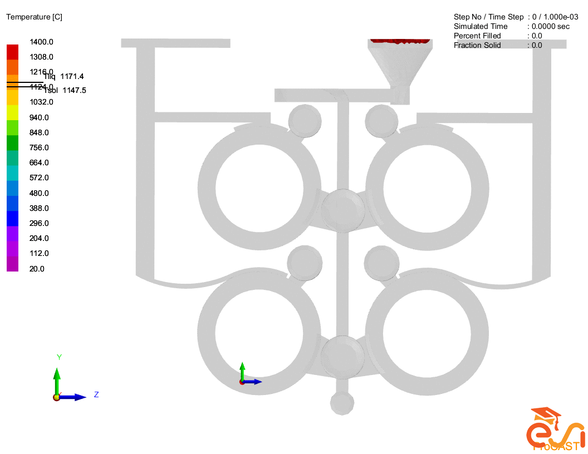
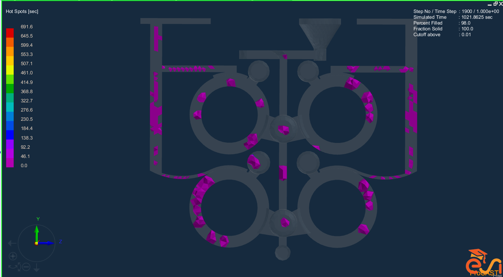
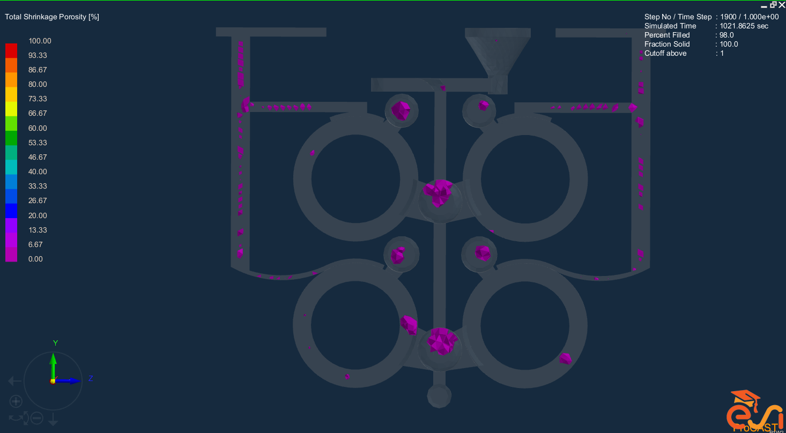

# ProCAST Casting Simulation

**English guide to the exported simulation results**  
Aynaz Chabouk | Academic simulation project

## Overview
This project presents ProCAST outputs used to examine temperature evolution during casting solidification, locate hot spots and inspect predicted shrinkage porosity.

## View the results
### Temperature evolution
[Open the thermal animation](procast-thermal.gif)

The animation shows how the calculated temperature field evolves over time. Interpret the colors using the legend shown in the export. A region that remains hotter for longer is a candidate for delayed solidification; the animation alone does not establish a defect or a measured temperature history.

### Hot spots

[Open the hot-spot map](procast-hotspot.png). This output helps locate regions that may solidify late. Such locations can inform examination of feeding arrangements and possible shrinkage risk.

### Predicted shrinkage porosity

[Open the shrinkage map](procast-shrinkage.png). This is a numerical prediction to be interpreted using the export's legend. It is not a photograph of measured porosity in a manufactured part.

## Scope of the available evidence
The portfolio supplies exported images and an animation. The available presentation does not include the full simulation setup, material-property inputs, boundary conditions, mesh-convergence study or experimental validation. Consequently, the outputs support a qualitative discussion of solidification and predicted defect locations; they do not establish a validated defect rate or optimized process.

## Main takeaway
The project demonstrates interpretation and communication of casting-simulation outputs, connecting thermal evolution with hot-spot and shrinkage assessment.
